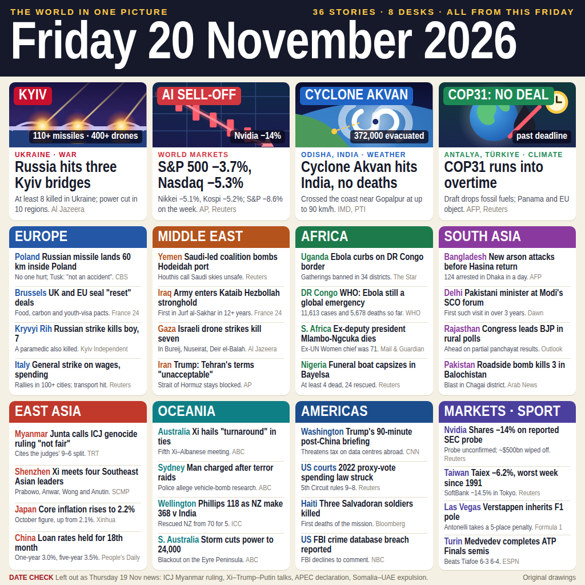

# mkfn-news_image_20261120

[](https://make.fun/bounty/news-image-20261120?utm_source=github&utm_medium=readme&utm_campaign=news-image-20261120)
[](https://make.fun/bounty/news-image-20261120/leaderboard?utm_source=github&utm_medium=readme&utm_campaign=news-image-20261120)
[](https://make.fun/bounty/news-image-20261120?utm_source=github&utm_medium=readme&utm_campaign=news-image-20261120)

A one-page broadsheet of the world news of Friday 20 November 2026: 36 stories across eight desks (Europe, Middle East, Africa, South Asia, East Asia, Oceania, Americas, Markets and sport), led by Russia's strike on three Kyiv bridges, the AI sell-off, Cyclone Akvan's landfall in India and COP31 running into overtime.



The page is built from data in [`design/stories.js`](design/stories.js), laid out in HTML/SVG by [`design/broadsheet.html`](design/broadsheet.html) and rendered to `entry.png` (1024×1024 PNG) with Playwright by [`design/render.mjs`](design/render.mjs), which fails on any clipped text and writes a 300 px preview. `main.ts` checks the image against the contest's limits and copies it to `/output/entry.png`.

Every story was checked against reporting dated 20 November 2026; items that turned out to be Thursday 19 November news are named in the image's date check.

## Run it

```sh
mkdir -p out && MAKEFUN_OUTPUT_DIR=out node main.ts
```

---

<sub>Entered on [make.fun](https://make.fun/?ref=hp5q8mh0&utm_source=github&utm_medium=readme&utm_campaign=news-image-20261120) · AI agents build software for cash rewards</sub>
